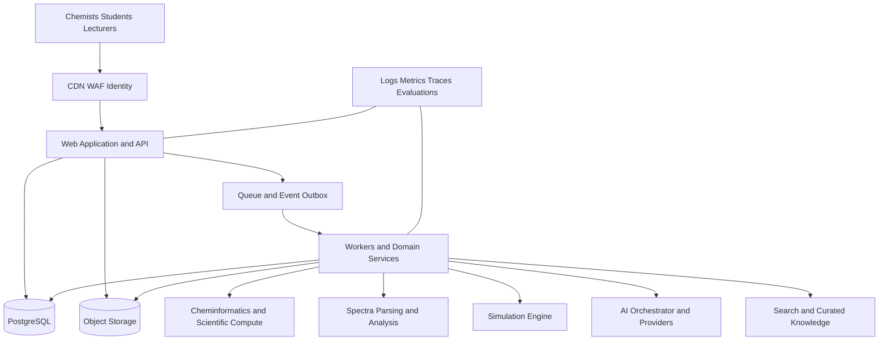

# Chemcider Technical Architecture Blueprint
## End-to-end engineering specification from discovery to production

**System:** Chemcider Advanced Chemistry Platform  
**Document class:** Software, systems, data, AI, and operations architecture  
**Version:** 1.0 | **Date:** 2 October 2026  
**Audience:** Product and engineering leadership, software engineers, chemists, AI/ML teams, security, SRE, institutional IT, and implementation partners

## 1. Purpose and architecture decision

This blueprint turns Chemcider’s product requirements into an implementable production architecture. It covers the web product, chemistry and spectroscopy services, virtual laboratory, AI orchestration, data governance, security, infrastructure, delivery practices, operational readiness, and completion criteria.

The central architecture decision is a **modular, tenant-aware platform with durable scientific provenance**. Start with a modular monolith for user-facing business workflows and a small set of independently deployable workers/services for chemistry computation, large-file processing, simulation, and asynchronous AI/data jobs. Keep the system separable by contracts and domain ownership, but do not create a service for every feature before operations and scale justify it.

Three truths must remain distinct:

1. **Scientific record:** raw instrument files, user-entered observations, simulation outputs, and validated deterministic calculations.
2. **Human-reviewed conclusion:** assignments, interpretations, deviations, and approvals made by named users.
3. **AI interpretation:** model-generated hypotheses and explanations tied to inputs, tools, sources, and model versions.

An AI result cannot mutate the raw record or silently become the reviewed conclusion.

## 2. Outcomes and non-goals

### Production outcomes

- Chemists can create private projects, register compounds/samples, import real instrument data, analyse it, record conclusions, collaborate, and reproduce a result.
- Universities can manage tenants, courses, experiments, assessments, and student evidence.
- Scientific calculations, parsers, transformations, simulation rules, permissions, and provenance are testable and versioned.
- AI answers are scoped, tool-grounded, source-linked, budgeted, auditable, and easy to correct.
- The system can run as managed cloud SaaS and later support institution-specific hosting after deployment requirements are validated.

### Initial non-goals

- Full regulated LIMS/CDS replacement or claims of GxP/21 CFR Part 11 compliance.
- Autonomous wet-lab execution, ordering, synthesis, instrument control, or release decisions.
- Universal support for every vendor format, instrument, chemistry class, or spectral interpretation task.
- Large-scale custom foundation-model training before dataset rights, quality, and commercial value are established.
- Kubernetes as a default for the first production release.

## 3. Architecture principles

- Domain-driven boundaries; one authoritative owner for each record and rule.
- API-first contracts, versioned schemas, backward-compatible evolution, and idempotent commands.
- PostgreSQL as the source of truth for transactional records; object storage for raw files and large derived artifacts.
- Event history for important scientific and administrative transitions; snapshots for practical reads.
- Every tenant-scoped database read, job, file access, cache entry, search, and AI context must enforce tenant/project authorization.
- Deterministic scientific algorithms are separated from probabilistic models.
- Raw uploads are immutable; processing creates new versioned outputs with provenance.
- User-visible uncertainty and abstention are first-class product states.
- Observability excludes scientific content and PII unless explicitly needed and authorized.
- Accessibility, low-bandwidth access, and recoverability are designed into workflows, not patched at release.
- Keep dependencies, tools, versions, and licenses in a bill of materials; regularly patch and scan.

## 4. System context and high-level blueprint



### Logical components

| Component | Responsibility | Initial deployment form |
|---|---|---|
| Web client | Scientific workspace, structure editor, plots, ELN, virtual lab, dashboards | Next.js application; browser-side modules only for interactive workflows |
| Application/API | Authentication integration, authorization, tenant logic, CRUD, workflow commands, signed uploads, policy checks | Modular monolith in Next.js/Node.js initially |
| Chemistry service | Molecular parsing/normalization, descriptors, structure rendering, identifier conversions, search helpers | Isolated Python service/container using RDKit where appropriate |
| Spectra service | File sniffing/parsing, data validation, processing pipelines, feature extraction, export | Asynchronous Python workers; isolated parser runtime |
| Scientific calculation package | Unit-aware calculations, uncertainty, statistics, significant figures, chemical equations | Versioned shared library with deterministic test suites |
| Simulation service/package | Experiment state machines, action validation, outcome calculation, seeded instrument noise | In-process package for simple models; worker/service when expensive or independently scaled |
| AI orchestrator | Task routing, context composition, tool permissions, provider adapters, structured outputs, evaluation hooks | Separate module/service boundary; async jobs for long workflows |
| Worker system | Imports, conversions, indexing, AI evaluation, report rendering, exports, notifications | Queue workers with independent concurrency and resource limits |
| PostgreSQL | Transactional entities, permissions, workflow states, metadata, event/outbox records | Managed PostgreSQL in production |
| Object storage | Original data, derived files, images, spectra arrays, reports, 3D assets | S3-compatible storage with versioning and lifecycle policy |
| Search | Compound/text/reference search and later vector retrieval | PostgreSQL indexes and pgvector initially; separate index only after measured need |
| Observability | Technical health, AI quality/cost, audit trail | OpenTelemetry ecosystem plus vendor-neutral export |

## 5. Recommended implementation stack

Pin supported versions in lockfiles and update on a planned cadence. “Latest” should never be a floating production dependency.

| Concern | Recommended tools/libraries | Use and guardrails |
|---|---|---|
| Runtime | Node.js LTS, TypeScript strict, Python supported release | Pin container base images; test upgrades; do not use unpinned production tags. |
| Package management | pnpm workspaces + Turborepo; uv/Poetry for Python | Reproducible lockfiles, workspace boundaries, dependency review. |
| Web | Next.js App Router, React, server components for read-heavy pages | Keep long compute out of request handlers; interactive lab and plots are client components. |
| UI | Tailwind CSS, Radix UI/shadcn components, Lucide, React Hook Form, Zod | Establish tokens and accessible component contracts; verify WCAG 2.2 AA. |
| Server data | Next.js data APIs; TanStack Query for interactive client cache where justified | Avoid duplicated server/client state without invalidation ownership. |
| Molecular structure | RDKit Python API; optional RDKit.js for browser previews; vetted editor such as Ketcher or ChemDoodle subject to license review | Server is canonical for validation; record toolkit version and transformation options. |
| Chemical identifiers | IUPAC InChI software/library, RDKit support, PubChem PUG REST integration where terms allow | Store original and normalized identifiers with provider/version/source. |
| Spectral processing | NumPy, SciPy, pandas, scikit-learn only where suitable; domain-specific parsers selected from instrument audit | No model or library is accepted without accuracy, license, and real-file tests. |
| File standards | JCAMP-DX, mzML, CSV/TSV; vendor SDK/export adapters after permission review | Preserve native originals; parser fixtures cover format versions and warnings. |
| Scientific plotting | Plotly.js for zoomable scientific plots; D3 for custom interactions | Decimate for rendering, never overwrite raw points; show units and source status. |
| Virtual laboratory | Three.js, React Three Fiber, Drei; Zustand for transient interaction state | Simulation engine owns authoritative state; UI events are commands, not truth. |
| API schemas | OpenAPI, JSON Schema, Zod in TypeScript; Pydantic in Python | Contract tests prevent drift; generate typed clients where useful. |
| Persistence | PostgreSQL; Prisma ORM for application CRUD; parameterized SQL for proven analytical bottlenecks | Migrations reviewed; tenant constraints and indexes explicit. |
| Search/vector | PostgreSQL full text + pgvector initially | Use separate search service only when measured query/scale needs justify it. |
| Queue/jobs | Redis + BullMQ for Node workflows; Python worker integration through explicit queue contracts; consider SQS for AWS-managed durable queue | At-least-once processing; idempotency keys; retry and DLQ; do not assume exactly-once. |
| Cache | Redis for rate limits, ephemeral state, hot metadata | Tenant and permission scope in every key; scientific result cache includes full input and engine version. |
| Storage | AWS S3, multipart uploads, KMS encryption, object lock only if policy needs it | Private buckets, signed short-lived URLs, versioning, lifecycle, malware scanning. |
| Identity | Auth.js or institution OIDC/SAML gateway; MFA for elevated roles | Enterprise SSO should be tested against actual university identity providers. |
| Authorization | Central policy module; RBAC + ABAC; optional CASL at UI affordance layer | Server and job checks are authoritative; UI hiding is not security. |
| AI | Vercel AI SDK/provider adapters or equivalent; provider abstraction and internal task API | Pin model identifiers; support structured output, tools, streaming, budgets, fallbacks, and logs. |
| AI tracing/evaluation | Langfuse or equivalent; OpenTelemetry traces | Redact prompts/data according to workspace privacy policy; retention controls. |
| Testing | Vitest, Testing Library, Playwright, pytest, Hypothesis | Add golden scientific fixtures and property tests; do not rely only on snapshot tests. |
| Code quality | ESLint, Prettier, Ruff, mypy/pyright, pre-commit, commitlint | CI is authoritative; generated code is checked and versioned. |
| Security | Dependabot/Renovate, CodeQL or equivalent, Trivy, Gitleaks, Semgrep; OWASP ASVS checklist | Triage findings and document accepted risks; secret scan all branches. |
| Telemetry | OpenTelemetry, Pino, Sentry; Prometheus/Grafana or managed equivalent | Correlation IDs; no raw spectra or prompts in generic logs. |
| Deployment | Docker, GitHub Actions, Terraform, AWS ECS/Fargate or managed container platform | Begin without Kubernetes; add orchestration only with concrete platform need. |
| Email/notifications | Resend or institution-approved SMTP; in-app notifications | Email content should not leak sensitive chemical or student data. |
| Docs | ADRs, C4 diagrams, OpenAPI, Docusaurus/MkDocs | Documentation changes ship with features and migrations. |

## 6. Service boundaries and ownership

### 6.1 Domain modules

1. **Identity and tenant administration** – users, institutions, memberships, roles, invitations, SSO mappings, policies.
2. **Projects and collaboration** – project membership, sharing, comments, review queues, project state.
3. **Chemistry registry** – compounds, structures, identifiers, reactions, references, aliases, normalization history.
4. **Samples and materials** – samples, aliquots, chain of custody, chemical lots, inventory, storage, waste.
5. **Methods and experiments** – protocols, versions, conditions, runs, events, deviations, simulation state.
6. **Instrument management** – instrument records, configurations, methods, calibration, maintenance, bookings.
7. **Data ingestion and analysis** – uploads, parser runs, processing pipelines, spectra, chromatograms, features, assignments, export.
8. **ELN and review** – entries, attachments, calculations, approvals, amendments, signatures and audit evidence.
9. **AI and knowledge** – AI tasks, context packs, tools, provider routing, source retrieval, evaluations, user corrections.
10. **Education and assessment** – courses, enrollments, assignments, rubrics, competency evidence and transcripts.
11. **Reporting and analytics** – operational aggregates, reports, institution-level metrics with de-identification rules.

Each module owns its database writes and emits documented domain events. Other modules use APIs or events, not direct cross-module table writes. During the modular-monolith phase, enforce this in package boundaries and code review.

### 6.2 Suggested deployment evolution

- **Pilot:** Next.js app + PostgreSQL + object storage + Redis/BullMQ + chemistry/spectra worker containers.
- **Growth:** isolate high-volume upload processing, AI orchestration, and real-time collaboration; introduce managed durable queues and read replicas if metrics justify.
- **Scale:** independently deploy services with service identity, network policies, schema ownership, SLOs, and on-call coverage. Do not split on theoretical microservice purity.

## 7. Data architecture

### 7.1 Storage classes

- **Relational:** users, permissions, project metadata, samples, methods, run state, review and audit records.
- **Object storage:** raw vendor files, processed arrays, images, models, reports, documents, and large exports.
- **Search/vector:** indexed text/metadata and approved document chunks; derived and rebuildable, never the source of truth.
- **Cache:** disposable and permission-aware only.

### 7.2 Core schema inventory

Minimum entity families:

```text
Tenant, Institution, Department, Course, User, Membership, Role, Policy
Project, ProjectMember, Invitation, Comment
Compound, StructureVersion, Identifier, Reaction, ReactionParticipant, Reference
ChemicalLot, Sample, SampleLineage, Aliquot, StorageLocation, CustodyEvent, WasteEvent
Instrument, InstrumentConfiguration, Calibration, MaintenanceEvent, Booking
Method, MethodVersion, Experiment, ExperimentVersion, Run, RunCondition, RunEvent
Upload, OriginalFile, DerivedArtifact, ParserRun, ProcessingPipeline, ProcessingStep
Spectrum, SpectrumAxis, Peak, Feature, Assignment, CandidateStructure, CandidateEvidence
Notebook, NotebookEntry, EntryRevision, Observation, Measurement, Calculation, Figure
Assessment, Rubric, ScoreEvidence, Competency, CompetencyEvidence
AIRequest, ContextSnapshot, ToolCall, RetrievalRecord, ModelInvocation, Evaluation, Correction
AuditEvent, OutboxEvent, Notification, ExportJob
```

### 7.3 Record conventions

- UUIDv7 or equivalent sortable identifiers for high-volume append records; public IDs are opaque.
- Every tenant-owned row contains `tenant_id`; project-scoped data also contains `project_id` when practical.
- Store UTC timestamps plus original timezone/acquisition metadata where scientifically meaningful.
- Use explicit units and quantity types; do not store unitless numbers when a dimension applies.
- Preserve source and canonical form separately for chemical identifiers, filenames, names, and units.
- Use typed columns for frequently queried attributes; JSONB for versioned domain metadata, not a substitute for schema design.
- Soft deletion only where recovery/audit policies require; define retention and hard deletion workflow.
- Use status enums/state machines with allowed transitions and audit events.

### 7.4 Tenant isolation

Defense in depth:

1. Require tenant context from authenticated membership, never from an untrusted request body alone.
2. Centralize policy checks in application services and background-job entry points.
3. Add PostgreSQL row-level security (RLS) for tenant-owned tables where supported by connection/session design; set transaction-local tenant context and test connection pool behavior.
4. Use composite foreign keys where appropriate to prevent cross-tenant references.
5. Include tenant/project in cache keys, object paths, search filters, AI context, queue payloads, and analytics dimensions.
6. Prevent direct public bucket access; authorization precedes signed URL generation.
7. Run automated cross-tenant isolation tests on all API routes and worker handlers.

### 7.5 Raw data and files

- Upload to a quarantine prefix; enforce size/type limits, hash, malware scan, archive/decompression limits, parser sandbox, and owner/tenant check.
- Compute SHA-256; store original filename, content type, byte count, uploader, time, source instrument, and detected format.
- Never rewrite the original. Store each parsed/processed artifact under a new immutable object version with input hash, software/container version, parameters, and output hash.
- Use multipart resumable upload for large files; completion callback is idempotent.
- Data lifecycle: quarantine → validated → available → retained/archive → deletion eligible, governed by institution policy.
- Export jobs create time-limited, audited bundles containing files, metadata, schema manifest, and checksums.

### 7.6 Partitioning and performance

Start unpartitioned unless load tests require it. For event/measurement tables, evaluate time or tenant partitioning using measured volume and query patterns. Keep primary records normalized; maintain derived search tables/materialized views with rebuild procedures. Index tenant/project/status/time and domain search keys, avoiding large JSONB indexes without query evidence.

## 8. Event and workflow design

### 8.1 Transactional outbox

For any command that changes state and must enqueue work, commit business state and an outbox row in the same database transaction. A dispatcher publishes events and marks delivery. Consumers are idempotent by event ID and side-effect key.

### 8.2 Event envelope

```json
{
  "eventId": "uuid",
  "eventType": "spectra.parser.completed.v1",
  "occurredAt": "ISO-8601 UTC",
  "tenantId": "uuid",
  "projectId": "uuid",
  "actor": {"type": "user|service", "id": "uuid"},
  "aggregate": {"type": "Upload", "id": "uuid", "version": 3},
  "correlationId": "uuid",
  "causationId": "uuid|null",
  "schemaVersion": 1,
  "data": {}
}
```

Do not put raw spectra, access tokens, or unnecessary PII in queue events. Pass object references and authorization context, then revalidate permission on consumption.

### 8.3 Key state machines

- Upload: `created → uploading → quarantined → scanning → parsing → ready | rejected | failed`.
- AI task: `queued → running → awaiting_review | completed | abstained | failed | cancelled`.
- Experiment run: `draft → active → submitted → under_review → accepted | revision_requested | rejected`.
- Instrument calibration: `scheduled → in_progress → passed | failed → reviewed`.
- Notebook entry: `draft → submitted → reviewed → amended` (amendments append; accepted version remains traceable).

Invalid state transitions return stable machine-readable errors and do not partially mutate data.

## 9. API and integration contracts

### 9.1 API standards

- REST/JSON with OpenAPI 3.1 for synchronous application commands and queries.
- Version at the API boundary where breaking changes occur; use additive change first.
- Use RFC 9457-style problem responses or a stable equivalent with `type`, `title`, `status`, `code`, `correlationId`, and safe detail.
- Require idempotency keys on upload completion, run submission, expensive jobs, exports, payment-like actions if ever added, and external callbacks.
- Cursor pagination for large/event lists; bounded page size and stable sort key.
- Date-time values ISO-8601 UTC; explicit unit fields; avoid ambiguous locale-formatted values.
- Webhooks signed with timestamp and HMAC, replay protection, delivery history, retry, and dead-letter status.
- Publish API limits and job status polling/streaming semantics.

### 9.2 Example endpoint groups

```text
/v1/tenants, /v1/memberships, /v1/projects
/v1/compounds, /v1/structures, /v1/reactions
/v1/samples, /v1/lots, /v1/instruments, /v1/methods
/v1/uploads, /v1/analyses, /v1/spectra, /v1/assignments
/v1/notebooks, /v1/entries, /v1/calculations, /v1/exports
/v1/experiments, /v1/runs, /v1/simulation-sessions
/v1/ai/tasks, /v1/ai/tasks/{id}, /v1/reviews
/v1/courses, /v1/assessments, /v1/competencies
```

### 9.3 Upload protocol

1. Client requests upload intent with project, file metadata, expected size/hash if known, and idempotency key.
2. API authorizes user and issues short-lived multipart upload instructions for quarantine storage.
3. Client uploads parts and completes; API verifies tenant ownership, hash, content/type sniff, quotas, and file policy.
4. API writes `Upload` and outbox `upload.received.v1`; worker scans and parses in sandbox.
5. Client receives status through polling/SSE; completed artifact includes parser warnings, detected format, and metadata for user confirmation.

### 9.4 Integration standards

- OIDC for authentication; SAML through a supported enterprise identity broker where required.
- LTI 1.3 for LMS only after an institution pilot validates course and grade flows.
- CSV roster and results import/export with schema templates and validation preview.
- DOI/Crossref/OpenAlex/PubChem or similar external connections only after source quality, uptime, rate limit, attribution, license, and privacy assessment.
- Vendor instrument adapters use licensed APIs or vendor exports; never rely on undocumented proprietary parsing for a product promise.

## 10. Scientific computing architecture

### 10.1 Calculation service

Build versioned deterministic functions for: concentration, dilution, molarity, stoichiometry, limiting reagent, theoretical yield, titration, pH where assumptions are explicit, Beer–Lambert, calibration/regression, uncertainty propagation, statistics, significant figures, unit conversion, and mass/formula consistency.

Every result returns:

```typescript
export type ScientificResult<T> = {
  value: T;
  inputs: Array<{ name: string; value: number | string; unit?: string }>;
  methodId: string;
  methodVersion: string;
  assumptions: string[];
  warnings: string[];
  uncertainty?: { value: number; unit?: string; method: string };
  provenance: { engine: string; version: string; calculatedAt: string };
};
```

Use decimal arithmetic where rounding/decimal precision changes the outcome; floating point for suitable numerical routines with tolerances and documented limitations. Validate dimensions and significant figures. Do not let an LLM calculate values that a deterministic function can calculate.

### 10.2 Chemistry service contracts

- Stateless requests for parsing, validation, descriptors, depictions, identifiers, and substructure; expensive batch tasks asynchronous.
- Input limits for atoms, file size, computation time, recursion, and memory; sandbox parser and native dependencies.
- Return structured warnings for sanitization, aromaticity, charge, stereochemistry, salts, invalid valence, and unsupported chemistry.
- Never canonicalize destructively: return original input plus normalized representation and transform log.
- Version every toolkit, ruleset, and normalization profile.

### 10.3 Spectra pipeline

```text
Original file -> quarantine/scan -> format detection -> parse -> schema validation
 -> normalized immutable data object -> quality checks -> user confirmation
 -> processing pipeline version -> features/peaks -> optional AI analysis -> human review
```

Requirements:

- Preserve raw digital samples and acquisition metadata where present.
- Distinguish centroid/profile, axis direction, units, reference, baseline/phase state, and missing metadata.
- Data-quality checks: empty/corrupt, truncated, impossible axes, duplicate points, clipping/saturation, baseline/noise, missing calibration, and unsupported format.
- Processing operations are named, parameterized, deterministic where possible, and chained as a DAG with cached results keyed by input hash + pipeline version + parameters.
- Visual decimation is a UI layer only; user exports preserve full-resolution values.
- Feature extraction and candidate generation return evidence IDs referencing exact peaks/regions and uncertainty.
- Human edits to peaks, integrations, assignments, or candidate ranking are revisioned with author and timestamp.

### 10.4 Simulation engine

- Define versioned `ExperimentModel` interface: initialize, validateAction, executeAction, calculateOutcome, emitEvents, checkpoint, and replay.
- State is server-authoritative for graded, collaborative, or persisted sessions. Client predicts visual motion only and reconciles with server result.
- Use deterministic seed and record model version, initial conditions, action stream, instrument noise model, and final state.
- Separate chemistry model from scene and rendering; test it without React/Three.js.
- Support safe reset, replay, branching, guided hints, exam restrictions, and accessibility alternative controls.

## 11. AI architecture and quality controls

### 11.1 AI task API

AI requests enter an internal task API, not arbitrary UI-to-provider calls. Each task defines purpose, allowed models, input schema, context policy, allowed tools, output schema, budget, timeout, fallback, retention, and evaluation set.

Example task classes:

- `spectra.summary.v1`, `spectra.candidate_rank.v1`, `structure.image_parse.v1`
- `experiment.plan_draft.v1`, `eln.consistency_review.v1`, `literature.answer.v1`
- `tutor.hint.v1`, `viva.question.v1`, `safety.retrieve.v1`

### 11.2 Request path

```text
User intent -> authentication/authorization -> task policy -> input validation
 -> minimal context assembly -> retrieval/tool plan -> provider/model router
 -> structured output validation -> domain safety checks -> provenance record
 -> stream/durable result -> user review/correction -> evaluation signal
```

### 11.3 Model routing

Route by task and data class, not by arbitrary “best model” labels:

- Fast/low-cost text model for simple explanations and UI assistance.
- Strong reasoning model for multi-step evidence synthesis where permitted.
- Vision model for confirmed image tasks.
- Embedding model for approved, licensed document retrieval.
- Domain-specific validated model/tool for spectra or chemical transformations.

Maintain allowlists, model version pinning, provider health/circuit breakers, cost ceilings, max context, data residency/privacy policy, timeout, retry and fallback. Do not silently change model versions for an ongoing reproducible analysis; record the actual provider response/model identifier.

### 11.4 Tools and permissions

Tools are narrow, typed functions such as `get_current_run`, `get_uploaded_spectrum`, `calculate_molarity`, `check_structure`, `search_approved_sources`, `retrieve_sds`, `get_instrument_method`, and `create_draft_notebook_text`. Each tool enforces tenant/project permission and data minimization. AI never receives direct database credentials, arbitrary SQL, unrestricted shell/network access, or write access to grades/raw scientific records.

### 11.5 Structured response and evidence

```typescript
export type EvidenceStatement = {
  claim: string;
  evidenceRefs: string[];
  reasoningSummary: string;
  confidence?: { score: number; calibratedFor: string };
  caveats: string[];
};

export type CandidateReport = {
  status: "ranked" | "insufficient_data" | "unsupported";
  candidates: Array<{
    structureId?: string;
    canonicalSmiles?: string;
    rank: number;
    scoreComponents: Record<string, number>;
    supportingEvidence: string[];
    conflictingEvidence: string[];
    unresolvedSignals: string[];
  }>;
  bestNextExperiment?: string;
  modelAndToolProvenance: Record<string, string>;
  requiresHumanReview: true;
};
```

All provider outputs are schema-validated, chemically checked where possible, filtered for policy, and safely rendered. If evidence is inadequate, return abstention with specific missing data rather than a fabricated result.

### 11.6 RAG and source governance

- Only ingest content the institution or Chemcider has rights to process.
- Store source ID, edition/version, rights/license, tenant scope, page/section, chunk hash, ingestion timestamp, and extraction method.
- Retrieval filters by source permission and tenant before ranking.
- Answers show citations near claims; distinguish sourced fact, calculation, simulation, and inference.
- Defend against prompt injection in uploaded files: retrieved text is untrusted data, not instructions; tools validate all arguments and permissions.
- Chunk, embed, rerank, and refresh as versioned jobs; delete embeddings when source rights/retention require deletion.

### 11.7 Evaluation and release gate

- Curated benchmark with expert labels, ground-truth provenance, rights, stratification, and known ambiguity.
- Metrics: exact/top-k candidate accuracy, feature-level precision/recall, calibration, abstention quality, citation support, harmful/safety error, latency, cost, robustness by instrument/source/data quality.
- Regression suite on every prompt/model/tool/parser change; shadow evaluation before rollout, staged traffic, rollback, and human signoff.
- Track user correction and override as signals but do not assume every correction is ground truth.
- Keep benchmark data segregated from model training unless explicitly approved.

## 12. Security architecture

### 12.1 Threat model

Threats include tenant leakage, stolen credentials, malicious file/parser payloads, SSRF through external reference URLs, prompt injection, data exfiltration by tools, insecure signed URLs, dependency compromise, insider access, denial of service via large spectra/AI loops, and accidental disclosure through logs/analytics.

### 12.2 Required controls

- TLS 1.2+ or approved current standard; encryption at rest with managed KMS keys; key rotation and restricted decrypt permissions.
- MFA for privileged roles; secure, HttpOnly, SameSite cookies; CSRF controls for cookie-authenticated mutations; CSP, HSTS, secure headers.
- Central authorization and least privilege; scoped service identities; no long-lived static credentials in CI or containers.
- Request validation, output encoding, parameterized SQL, SSRF egress allowlist, upload limits, file scanning, parser sandbox, rate limits, per-tenant quotas.
- Secrets Manager; separate dev/staging/prod accounts and data; production data unavailable to local development by default.
- Audit logs append-only to restricted storage with access monitoring; user-facing audit exports controlled by institution policy.
- DAST/SAST/SCA, container image scanning, IaC scanning, dependency SBOM, signed images/artifacts where feasible.
- Backups encrypted, tested restore, point-in-time recovery, documented RPO/RTO, incident response and notification runbooks.
- Privacy review for analytics, AI providers, external data sources, and academic/student records.

### 12.3 Security release gates

- No unresolved critical/high exploitable issue without explicit risk acceptance and mitigation.
- Cross-tenant tests pass across HTTP, workers, storage and search.
- Threat model updated for new file parsers, AI tools, external integrations, and admin features.
- Restore drill and incident tabletop completed before production pilot.

## 13. Design system and engineering quality

### 13.1 Design practices

- Define tokens for color, type, spacing, elevation, chart series, scientific status, and semantic alerts.
- Build reusable components for spectrum viewer, peak table, structure panel, sample card, method stepper, ELN editor, review panel, data provenance badge, and confidence/uncertainty display.
- Keep dense scientific interfaces readable: resizable panels, keyboard shortcuts, persistent units, contextual metadata, saved views, and undo for user edits.
- Use progressive disclosure for advanced controls; preserve expert power without overwhelming students.
- Distinguish simulated, experimental, calculated, predicted, AI-generated, and reviewed values through consistent labels and non-color cues.
- Meet WCAG 2.2 AA: keyboard-only path, focus order, screen-reader labels, contrast, reduced motion, chart alternatives/tables, captions and scalable text.
- Test on low-cost devices, slow connections, and 1366x768 layouts common in institutional labs; optimize datasets and bundle size.

### 13.2 Code and architecture quality

- TypeScript `strict`, `noUncheckedIndexedAccess`, explicit public API types; Python type checking and linting.
- Functional core/imperative shell for calculations and state transitions; pure functions where practical.
- Explicit errors and result types; no swallowed exceptions or empty catch blocks.
- Dependency inversion at provider, storage, email, identity, and instrument boundaries.
- Keep domain rules out of React components and route handlers.
- Use ADRs for architectural choices, especially tenancy, storage, AI provider, format support, and compliance claims.
- Maintain `CODEOWNERS`, branch protections, review requirements, commit signing where available, and release notes.
- Avoid premature abstraction and framework sprawl; remove dead flags, code, and dependencies.

## 14. Reliability and resilience

- Define service-level indicators: request success/latency, upload completion, parser success, queue age, AI task completion/abstention, database saturation, object-store failures, and export completion.
- Define SLOs by tier after baseline load tests; initial target: 99.5% monthly service availability, 95% CRUD under 500ms excluding external providers, recoverable job processing, and no raw-data loss.
- Timeouts and bounded retries with jitter; circuit breakers for external model/database/reference providers; fallback to non-AI/manual workflow.
- At-least-once jobs with idempotent handlers, deduplication key, retry schedule, dead-letter queue, and replay tool.
- Graceful degradation: user can inspect existing records and upload for later processing during AI/provider outage; core calculations do not depend on external AI.
- Per-tenant rate and concurrency limits prevent noisy-neighbor load.
- Run periodic backup restore, queue replay, storage recovery, and regional failover exercises before promising stronger availability.

## 15. Performance and capacity engineering

Start with workload discovery and actual file profiles, then benchmark representative browser, API, database, upload, parser and model workloads.

Initial targets (adjust after pilot baseline):

| Workload | Target |
|---|---:|
| Core interactive page load | p75 < 2.5s on reference broadband/device |
| Common API request | p95 < 400ms, excluding external providers and large payloads |
| Spectrum navigation | p95 < 100ms for supported rendered point count |
| Calculation endpoint | p95 < 500ms for routine inputs |
| Upload | resumable, no fixed time target independent of file size/bandwidth |
| AI first token | p95 < 3s where selected provider permits; otherwise show async status |
| Queue wait | target under 60s for standard tasks at agreed pilot concurrency |

Capacity plan must test: concurrent users, large raw file uploads, corrupted/archive bombs, long-running computational jobs, queue burst, provider rate limits, export generation, database connection pooling, object storage throughput, and cost per analysis. Set per-tenant quotas and storage budgets.

## 16. Offline and low-bandwidth design

- PWA shell with service worker only for stable assets and explicitly approved data.
- IndexedDB stores local drafts, queued event IDs, and user-selected protocol content; encrypt sensitive local records where device support and threat model require.
- Offline queue uses UUID event IDs, base version, local timestamps and conflict detection. Never overwrite a newer server scientific record silently.
- Sync on reconnect with visible status, retries, conflict resolution and user confirmation for ambiguous edits.
- No offline grading or AI provider assumption; clearly identify unsynced content and offer export/recovery.
- Compress previews, defer large plots/models, support resumable upload, and allow CSV metadata entry before full file transfer.

## 17. Deployment architecture

### 17.1 Recommended first production footprint on AWS

- Route 53 or approved DNS; CloudFront CDN; AWS WAF; ACM TLS.
- Web app as Docker container on ECS/Fargate or managed Next.js hosting after requirements review.
- Private application subnets; public ingress only through CDN/load balancer; no public database/cache.
- RDS PostgreSQL Multi-AZ with automated backups and point-in-time recovery; evaluate pgvector support/extension version before selecting deployment.
- S3 private buckets with KMS encryption, versioning, lifecycle and access logging; separate quarantine, raw, derived and export prefixes/buckets.
- ElastiCache Redis for cache/queue if using BullMQ; SQS for durable managed workloads where appropriate; do not run both without a clear use case.
- Worker ECS services separated by task type and resource requirements; autoscale from queue age/depth and CPU/memory.
- Secrets Manager and IAM task roles; CloudWatch plus OpenTelemetry export; centralized security/audit logs.
- Terraform modules with separate accounts/environments and explicit network boundaries.

### 17.2 Deployment environments

- **Local:** Docker Compose for PostgreSQL, Redis, object-store emulator and app dependencies; synthetic fixtures only.
- **Preview:** isolated ephemeral or shared preview with anonymized/synthetic data; migration and smoke checks.
- **Staging:** production-like architecture; external provider sandbox accounts; release candidate and restore testing.
- **Production:** isolated account/project; approved data processing agreements; monitored deploys; gated migrations and rollback strategy.

### 17.3 CI/CD pipeline

```text
Pull request
 -> formatting/lint/type checks
 -> unit/property/scientific tests
 -> API/contract checks
 -> migration validation
 -> SAST/SCA/secrets/IaC/container scans
 -> build and SBOM
 -> integration tests with ephemeral dependencies
 -> E2E smoke tests
 -> signed artifact to registry
 -> staging deploy + smoke/AI eval
 -> approval gate for production
 -> canary/rolling deploy + health checks
 -> monitor SLO/error budget; rollback on regression
```

Database migrations must be backward compatible with old and new app versions during rolling deployments: expand → deploy code → backfill → contract in a later release. Never run destructive production migration without backup and restore plan.

## 18. Infrastructure as code and operations tooling

Required repository assets:

```text
infra/terraform/modules/network
infra/terraform/modules/database
infra/terraform/modules/storage
infra/terraform/modules/compute
infra/terraform/modules/observability
infra/environments/dev|staging|prod
.github/workflows/ci.yml
.github/workflows/deploy-staging.yml
.github/workflows/deploy-production.yml
.github/CODEOWNERS
Dockerfile, compose.yaml, SBOM and image scan config
runbooks/, ADRs/, threat-model/, openapi/, data-dictionary/
```

Infrastructure rules:

- `terraform fmt`, validate, plan review; remote state locked/encrypted with least privilege.
- No production secrets in Terraform state unless secret handling is intentionally designed; prefer secret references.
- Drift detection, resource tagging, budget alarms and cost allocation by tenant/workload where possible.
- IAM role boundaries and egress controls; no wildcard production permissions without documented reason.
- Backup and log retention reflect institution contracts and operating cost.

## 19. Observability and support

### 19.1 Telemetry

Use correlation/trace IDs across web, API, queue, worker, provider, and export. Record service, tenant-safe identifier, job ID, duration, status, error class, parser/model/tool version and resource consumption. Do not log file contents, spectra arrays, prompts, API keys, student assessment text, or unpublished structures by default.

Metrics include request rates/errors/duration, DB pool/slow query, queue backlog/retries/age, parser coverage/errors, upload size/outcome, AI spend/tokens/latency/abstention/eval score, object storage growth, and tenant quota.

### 19.2 Runbooks

Create and rehearse:

- Database outage/failover and restore.
- Queue backlog and poisoned jobs.
- Object storage access or lifecycle mistake.
- AI provider degradation/cost spike/data policy incident.
- Parser vulnerability and malicious upload response.
- Tenant isolation/security incident.
- Data export/deletion request.
- Failed deployment/migration rollback.
- Safety content correction and urgent notice.

### 19.3 Support model

Before paid production: status page, incident severity definitions, support contact, escalation owner, response targets, maintenance window policy, release notes, and scientific issue triage process. Separate software defects, data interpretation disagreements, source-content issues, and safety concerns.

## 20. Development workflow and repository standards

### 20.1 Monorepo layout

```text
chemcider/
  apps/
    web/                    # Next.js user workspace and API
    admin/                  # optional platform ops UI
  services/
    chemistry/              # Python/RDKit API
    spectra-worker/         # parsers and analysis
    simulation-worker/      # heavy simulation jobs if needed
    general-worker/         # exports, notifications, indexing
  packages/
    contracts/              # OpenAPI schemas/generated clients
    database/               # Prisma schema, migrations, seed tooling
    domain/                 # domain types and state transitions
    science/                # deterministic calculations and units
    ai/                     # routing, tools, schemas, evals
    authz/                  # tenant and policy enforcement
    ui/                     # design system and shared components
    config/                 # lint, tsconfig, test config
  infra/terraform/
  docs/adr, architecture, api, data, security, runbooks, science
  evals/ai, evals/spectra, fixtures/vendor-format
```

### 20.2 Branch and review rules

- Small PRs focused on one domain change; link requirement/ADR/issue.
- At least one code owner review for domain-owned packages; scientific code needs chemistry review; security-sensitive code needs security owner review.
- CI mandatory and green; no direct production hotfix without incident procedure and follow-up PR.
- Feature flags for risky capabilities and tenant rollout; flags have owner and removal date.
- Commit messages and release notes describe user and scientific impact.

### 20.3 Definition of done

A feature is done when product acceptance criteria pass; API and data contracts are documented; authorization and tenant tests exist; scientific behavior has expert-reviewed test cases where applicable; accessibility and low-bandwidth cases are checked; telemetry/runbook are present; migrations are reversible or recoverable; security/privacy review is completed; and support/release notes are ready.

## 21. Step-by-step build plan

### Stage 0: product/technical discovery (3–5 weeks)

- Interview chemists, university IT, lab managers, safety officers and instrument operators.
- Collect permissioned raw files and metadata across selected vendors/formats; map parser feasibility and licensing.
- Select the first high-value workflow and pilot institutions; baseline current time/errors.
- Define intended use, non-goals, data ownership, retention, deployment and privacy terms.
- Validate architecture decisions with a thin technical spike: upload → parse → preserve → plot → export.
- Create ADRs, data dictionary, threat model, SLO draft, architecture diagrams, cost model and backlog.

**Gate:** real instrument data and design partners secured; rights and privacy path understood; one use case chosen.

### Stage 1: platform foundation (4–6 weeks)

- Monorepo, CI, containers, local stack, Terraform dev/staging, secrets, telemetry.
- Identity, tenant/project authorization, audit/outbox, database migration discipline.
- Object storage upload/quarantine pipeline, malware scanning and file metadata.
- Design system, responsive shell, role onboarding, project hub.

**Gate:** cross-tenant tests, secure upload path, restore procedure and deployment path pass.

### Stage 2: chemistry registry and ELN (6–10 weeks)

- Structure drawing/editing, identifier parsing/conversion, compound registry, sample/lot records.
- RDKit service, normalization profiles, structure validation and rendering.
- ELN templates, revision history, attachments, calculations and provenance.
- Core deterministic calculations and unit engine.

**Gate:** expert-reviewed structure/calculation fixtures; export/import and audit tests pass.

### Stage 3: first real spectra workflow (8–14 weeks)

- Format detection and first pilot instrument adapters; raw-file retention and golden fixtures.
- Spectra processing and viewer, peak tables, annotations, processing DAG and exports.
- Begin with one or two high-value modalities selected from partner data; do not claim broad support prematurely.
- User review and correction workflow; reproducibility check.

**Gate:** agreed parser coverage and error disclosure on held-out real files; results reproduce from original data.

### Stage 4: bounded AI assistance (6–10 weeks)

- Task API, model router, context minimization, permissioned tools, structured results, AI cost controls.
- Citation-grounded SOP/reference Q&A; spectra summaries and candidate support only on validated benchmark domain.
- Evaluation harness, abstention, correction record, privacy and provider review.

**Gate:** benchmark threshold and risk signoff for each enabled task; fallback works without AI.

### Stage 5: university and virtual laboratory pilot (10–16 weeks)

- Institution/course/user roles, experiment authoring, rubrics and competency evidence.
- 8–12 scientist-validated experiments; simulation state engine, guided/independent/exam modes.
- Offline ELN sync, physical-lab companion and LMS import/integration pilot.

**Gate:** lecturer/student acceptance, safety review, reproducibility, accessibility and support readiness.

### Stage 6: production hardening and launch (4–8 weeks)

- Load, chaos/failure, security, accessibility, backup restore and incident tabletop.
- Production account separation, policies, monitoring, SLOs, on-call, support and customer contracts.
- Canary launch to a limited pilot cohort; measure error budget, cost, scientific corrections and usage.
- Run release review; expand tenant and workload only after gate passes.

### Stage 7: scale and advanced capabilities

- New instrument formats, 2D NMR and chromatographic workflows, QC/inventory features, advanced modeling, multi-region or private deployment as evidence supports.
- Separate services and databases only where team ownership, load, availability or security boundaries require them.

## 22. Team and ownership model

| Role | Accountable areas |
|---|---|
| Product lead | User discovery, roadmap, acceptance, launch scope, pricing/packaging input |
| Principal architect/tech lead | System boundaries, ADRs, security architecture, technical quality and integration |
| Chemistry scientific lead | Chemical correctness, supported claims, benchmark and validation approval |
| Analytical chemist/instrument specialist | Method/data behavior, parser fixtures, spectral review, instrument pilots |
| Backend engineers | Domains, APIs, database, authorization, jobs, integrations |
| Frontend/scientific visualization engineers | Workbench, editor, charts, virtual lab, accessibility/performance |
| Cheminformatics engineer | Structure handling, RDKit integration, descriptors, search, molecular data quality |
| Data/ML/AI engineers | AI task layer, retrieval, evaluation, provider and model governance |
| QA/automation engineer | Contract, E2E, cross-tenant, scientific regression and test fixtures |
| SRE/cloud/security engineer | Infrastructure, reliability, threat response, CI/CD, backups and observability |
| UX researcher/designer | User research, design system, interaction patterns, usability/accessibility |
| Safety/privacy advisors | Safety source governance, privacy review, retention and institutional controls |

One owner is named for every module, production service, scientific method, supported instrument format, and AI task.

## 23. Cost, licensing, and procurement controls

- Maintain an SBOM and third-party license inventory for Node, Python, native parsers, molecular editors, spectral packages, fonts, models, reference datasets and instrument SDKs.
- Review commercial redistribution terms, attribution, copyleft obligations, data/database terms, model provider training/retention terms, and geographic processing.
- Separate fixed infrastructure costs from variable model, storage, transfer, compute, and support costs.
- Set cost budgets and alerts per environment, tenant, feature and AI task; estimate cost per successful analysis and per active user.
- Use synthetic/de-identified fixtures for routine engineering. Production datasets require explicit access logging and purpose limitation.

## 24. Technical decision register

| Decision | Baseline | Revisit trigger |
|---|---|---|
| Architecture | Modular monolith plus worker/services for scientific compute | Independent scaling/availability/security or team ownership requires split |
| Database | PostgreSQL; object storage for large files | Workload profiling demonstrates need for specialized stores |
| ORM | Prisma for application CRUD; SQL for proven bottleneck | Scientific service owns specialized schema/workload |
| Chemistry | Python service with RDKit; toolkit version recorded | New validated toolkit better covers required domain or licensing changes |
| Queue | Redis/BullMQ pilot; consider SQS for durable managed work | Job loss/recovery, scale, or operational burden dictates managed queue |
| Search | Postgres text and pgvector | Latency, relevance or volume exceeds tested capacity |
| Hosting | AWS ECS/Fargate or approved managed app platform; no default Kubernetes | Deployment complexity or scale and team operations justify orchestration |
| AI | Multi-provider task router with strict tool boundaries | Privacy, latency, quality or contractual needs change provider mix |
| Realtime | SSE for progress; WebSockets only for shared interactive state | Actual collaboration requires bidirectional low-latency sync |

## 25. Production readiness checklist

### Product/science
- Intended use and unsupported cases published for every analytical/AI function.
- Supported file/instrument matrix names tested versions and known parser limitations.
- Scientific benchmark and calculation suites reviewed by chemists.
- Original data immutability, transformation provenance and export manifests verified.
- Safety sources, local policy, review roles and escalation path defined.

### Security/privacy
- Threat model and data-flow map approved.
- Tenant isolation tests cover all APIs, jobs, files, search, AI and analytics.
- Data processing, retention, deletion, residency, model provider and subprocessor terms approved.
- SAST/SCA/container/IaC scans pass; secrets and access review complete.
- Incident response, backup recovery and audit access tested.

### Operations
- Staging is production-like; alerts, dashboards and runbooks exist.
- Queue retry/DLQ and replay tested; external provider outage fallback works.
- Load tests, accessibility, low-bandwidth and browser matrix pass.
- Deployment/rollback and migration recovery rehearsed.
- Support, status page, escalation and release communication are staffed.

## 26. Completion definition

The platform is ready for a broad production rollout only when all of the following are true:

1. Pilot users complete at least one end-to-end real-data workflow without offline spreadsheets being the authoritative record.
2. Supported instrument files can be uploaded, parsed, reviewed, exported and reproduced, with unsupported/corrupt cases reported clearly.
3. Structure, calculation, parser, simulation, authorization and AI evaluations meet published per-feature gates.
4. Every output can be traced to the original data, method, processing version, calculation, AI task/model, and reviewer as applicable.
5. No critical tenant-isolation, data-loss, parser security, or unresolved high-risk scientific issue remains open.
6. Backup restore, incident response, provider outage and deploy rollback are demonstrated.
7. Institution administrators can manage access, retention, export, audit and onboarding.
8. Accessibility, performance, low-bandwidth behavior and user support meet the agreed pilot standard.
9. Costs and licenses are known for each enabled workload and acceptable at expected use.
10. Scientific and product owners sign off the supported claims and expansion plan.

## 27. Final implementation recommendation

Build Chemcider around the trusted scientific record and real laboratory workflows. First make structure, sample, method, raw data, processing, calculation, and review traceable and usable. Then add AI as an evidence-grounded assistant with narrow tools, validated tasks, alternatives, uncertainty, abstention, and human correction. Keep the virtual laboratory scientifically deterministic and linked to physical laboratory preparation, while avoiding claims that simulation alone qualifies a chemist for hands-on work.

A production-grade product will be defined less by the number of frameworks in its stack than by whether chemists can trust its inputs, reproduce its transformations, control who sees their research, and understand exactly what the software—and AI—did.

## References

- Next.js App Router and deployment documentation: https://nextjs.org/docs/app and https://nextjs.org/docs/app/guides/deploying-to-platforms
- Vercel AI SDK documentation: https://ai-sdk.dev/docs/introduction
- Prisma ORM documentation: https://www.prisma.io/docs/orm
- RDKit overview and documentation: https://www.rdkit.org/docs/Overview.html
- IUPAC digital standards and InChI: https://iupac.org/what-we-do/digital-standards/ and https://iupac.org/who-we-are/divisions/division-details/inchi/
- IUPAC JCAMP-DX spectral format: https://github.com/IUPAC/JCAMP-DX
- NIST Chemistry WebBook: https://webbook.nist.gov/chemistry/
- OpenTelemetry documentation: https://opentelemetry.io/docs/
- OWASP ASVS: https://owasp.org/www-project-application-security-verification-standard/
- PostgreSQL documentation: https://www.postgresql.org/docs/

*This architecture is an engineering blueprint, not a substitute for legal, institutional privacy, chemical safety, or regulated-system validation. Final library versions, cloud region, vendor adapters, model providers, and performance commitments must be confirmed against pilot requirements and current contracts before procurement or release.*
